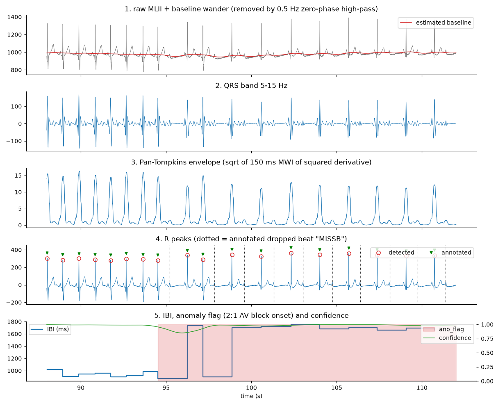
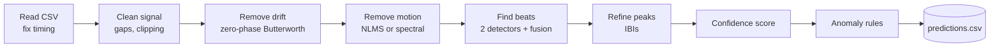

# CARDIO-CODE

**DSP-driven arrhythmia detection in motion-corrupted PPG and ECG: signal processing only, no machine learning.**

Built for **Milan 2026 at IIT Hyderabad**, representing **Hostel Ramanujan**.
Team Ramanujan: Darshan, Piyush.

CARDIO-CODE reads a noisy wearable heart signal from a CSV file. For every sample it reports:
- where the heartbeats are;
- the time between beats;
- whether the rhythm looks abnormal;
- how far the signal can be trusted.

Every step is classical, explainable signal processing. Every anomaly flag can be traced to a named rule.

<p align="center">
  
  <br><em>ECG stages around the onset of a 2:1 heart block: drift removal, QRS band, envelope, detected peaks,
  and IBI with anomaly flag and confidence.</em>
</p>

---

## Highlights

- **One file, three dependencies.** `pipeline.py` needs only numpy, scipy and pandas. All parameters are in one
  dictionary `P`.
- **ECG or PPG, detected automatically.** The mode comes from the column name, or from the signal's frequency
  content.
- **Robust input handling.** Delimiter, column roles and time units are detected. Jittered timestamps are
  resampled, and gaps are masked.
- **Motion handling for PPG.** It uses an NLMS adaptive filter when accelerometer columns are present, and
  short-time spectral motion removal with a Viterbi heart-rate tracker otherwise.
- **Two beat detectors, fused under a noise gate.**
  - Pan–Tompkins (ECG) or Elgendi (PPG);
  - a heart-rate-guided dynamic-programming selector.
  The gate keeps irregular rhythms such as AF from being "smoothed away".
- **Five explainable anomaly rules:** pause, bradycardia, premature beat, ectopic shape (ECG) and AF-type
  irregularity. `--events` exports each episode with its rule and a plain-text reason.
- **Per-sample confidence score** from beat-to-template similarity.

## Results

| Data | Beat F1 | IBI MAE | Anomaly F1 |
|---|---|---|---|
| `ecg.csv`: MIT-BIH record 231 (real ECG; also used for tuning) | 1.000 | 0.99 ms | 0.992 |
| 44 team-built stress sets (real noise, real arrhythmias, synthetic PPG), mean | 0.925 | – | 0.878 |
| Synthetic PPG fixture **with** accelerometer | 0.996 | – | 0.865 |
| Synthetic PPG fixture **without** accelerometer | 0.943 | – | 0.730 |
| Worst case: ECG + electrode-motion noise at 0 dB | 0.776 | – | 0.484 |

Runtime is about 2 s for a 30-minute record at 360 Hz. Full results and the method are in [`report.pdf`](report.pdf).
The raw scores are in `dev/results_*.json`.

## Quick start

```bash
git clone https://github.com/Anandpiyush21/CardioCode_Milan.git && cd CardioCode_Milan
python3 -m venv .venv
.venv/bin/pip install -r requirements.txt

.venv/bin/python pipeline.py --input your_signal.csv --output predictions.csv
```

### Try it without any data
`dev/make_fixtures.py` generates a realistic 10-minute wrist-PPG test signal with known ground truth. It includes
motion, an AF episode, premature beats, dropped beats, timestamp jitter and gaps, with and without an
accelerometer.

```bash
.venv/bin/python dev/make_fixtures.py --out-dir demo_data
.venv/bin/python pipeline.py -i demo_data/ppg_acc.csv -o demo_data/pred_acc.csv \
        --annotation demo_data/ppg_acc_ann.txt --events demo_data/events_acc.json
```

Expected console output:

```
channel=PPG fs=64.00 mode=ppg resampled=True acc=True beats=694 median_HR=69.5 bpm anomalous=12.9% mean_conf=0.94 time=0.42s -> demo_data/pred_acc.csv
{"lag_ms": 250.3, "beats_ref": 693, "beats_det": 694, "Se": 0.9971, "PPV": 0.9957, "F1": 0.9964, "ibi_mae_ms": 8.1542, "ano_Se": 0.8365, "ano_PPV": 0.8958, "ano_F1": 0.8652}
```

The time value depends on your machine. `lag_ms ≈ 250` is the pulse transit time between the ECG R peak and the
PPG pulse peak. It is not an error.

## Input and output

**Input:** any CSV with a PPG or ECG column, an optional time column (any unit) and optional accelerometer columns.
Columns are recognised by name (e.g. `PPG`, `pleth`, `ECG`, `MLII`, `ACC_X`, `Timestamp`).

**Output:** `predictions.csv`, one row per input sample:

| Column | Meaning |
|---|---|
| `Timestamp` | time of the sample (s) |
| `Is_peak` | 1 if a heartbeat peak is at this sample |
| `Ibi_ms` | inter-beat interval ending at the latest beat (ms), held until the next beat |
| `ano_flag` | 1 inside a suspected abnormal-rhythm episode |
| `confidence_score` | 0–1 signal-quality score |

**Options**

| Flag | Purpose |
|---|---|
| `--fs HZ` | sampling rate when there is no time column (**default 360 Hz**; always set it for other rates) |
| `--mode auto\|ecg\|ppg` | force the signal type |
| `--channel NAME` | choose the analysed column (PPG is preferred when both PPG and ECG exist) |
| `--annotation FILE` | print beat and anomaly accuracy against reference annotations (WFDB `rdann` text) |
| `--events FILE` | write each anomaly episode with its rule and reason as JSON |
| `--ibi-fill hold\|zero` | value of `Ibi_ms` on non-peak rows |

## How it works



| Stage | Method |
|---|---|
| Drift removal | zero-phase Butterworth: ECG 0.5 Hz high-pass, PPG 0.5–8 Hz band-pass; adaptive 50/60 Hz notch for ECG |
| PPG motion, with accelerometer | NLMS adaptive filter (8 taps/axis, μ = 0.01, about 25 Hz), used only if PPG/accelerometer coherence > 0.1 |
| PPG motion, without accelerometer | STFT (8 s / 1 s) → harmonic-sum spectrum → Viterbi HR track → subtract strong non-cardiac lines |
| Beat detection | Pan–Tompkins (ECG) or Elgendi (PPG) + HR-guided dynamic programming, fused per 10 s window under a noise gate |
| Peak timing | dominant-polarity refinement (ECG) and parabolic sub-sample interpolation |
| Confidence | correlation with a local median beat template × amplitude consistency × validity, smoothed over 2 s |
| Anomalies | pause, bradycardia (< 45 bpm), premature beat, ectopic morphology (ECG), AF-type irregularity (16-beat window) |

## Repository structure

```
├── pipeline.py              # the complete pipeline (single file, parameters in P)
├── requirements.txt
├── predictions.csv          # output for the supplied ecg.csv (MIT-BIH record 231)
├── report.pdf               # technical report
├── report_src/report.tex    # LaTeX source of the report
├── presentation/            # slide deck (Beamer source + PDF)
├── plots/                   # report figures
└── dev/                     # evaluation and data-generation tools (not needed to run)
    ├── make_fixtures.py     # self-contained synthetic PPG test fixtures
    ├── make_data.py         # ECG + NSTDB noise stress sets, synthetic PPG
    ├── make_afdata.py       # MIT-BIH arrhythmia test sets
    ├── stress.py            # score the pipeline on all stress sets
    ├── compare.py           # head-to-head of design variants
    ├── baselines/           # the two design branches the final pipeline was built from
    └── results_*.json       # stored evaluation results
```

### Reproducing the stress tests
The full evaluation needs data that is not in this repository:
- the supplied `ecg.csv` and `annotation.txt`, in the repository root;
- MIT-BIH Arrhythmia records 201, 202, 203, 210, 219, 221, 222 in `dev/mitdb/`;
- the NSTDB noise records `em`, `ma`, `bw` in `dev/nstdb/`.

The MIT-BIH and NSTDB records are available from [PhysioNet](https://physionet.org/). Then run:

```bash
python3 dev/make_data.py && python3 dev/make_afdata.py
python3 dev/stress.py --save results.json
```

`dev/compare.py` and `dev/compare_fixtures.py` expect the interpreter at `.venv/bin/python`.

## Limitations

- All PPG test data is synthetic: there is no validation on real PPG recordings yet.
- Parameters were tuned on our own test sets, so scores on unseen data may be lower.
- Very strong in-band motion (larger than the pulse) lowers beat F1 to about 0.73.
- PPG peak times are reported as detected, not shifted back by the pulse transit time.
- Offline processing of whole files. This is a research prototype, not a medical device.

## Team

**Team Ramanujan**, representing **Hostel Ramanujan** at **Milan 2026, IIT Hyderabad**:
- Darshan
- Piyush

The task was to build the layer between a raw wearable heart signal and an actionable insight, using signal
processing only.
